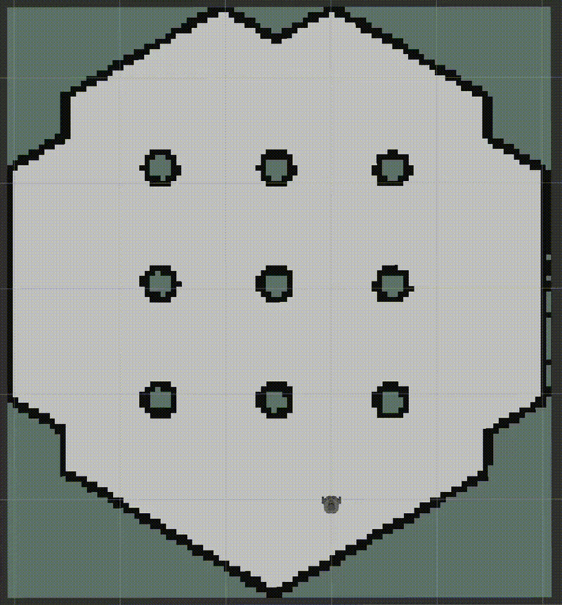
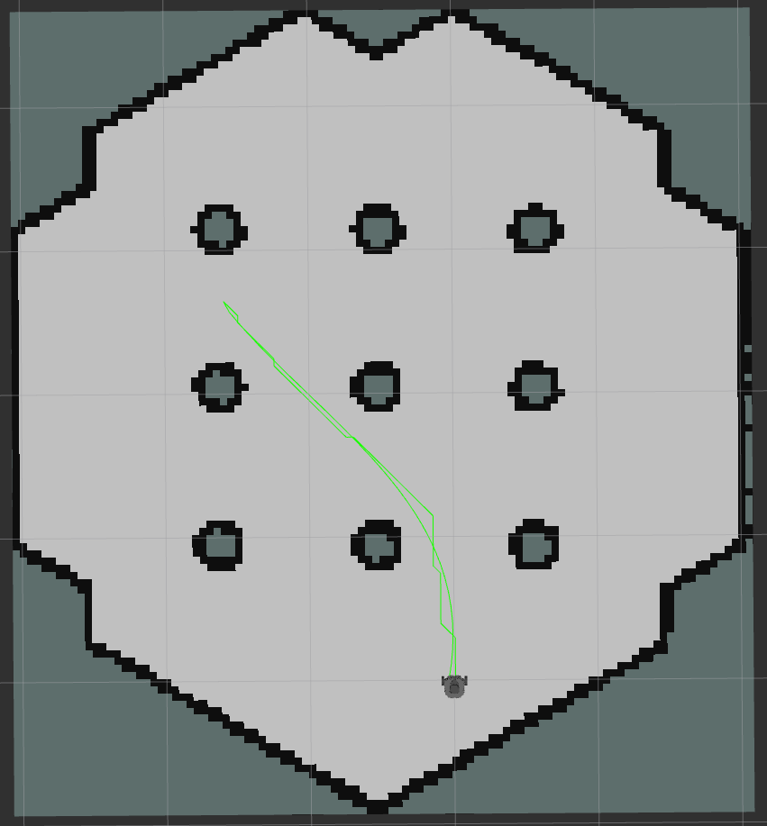
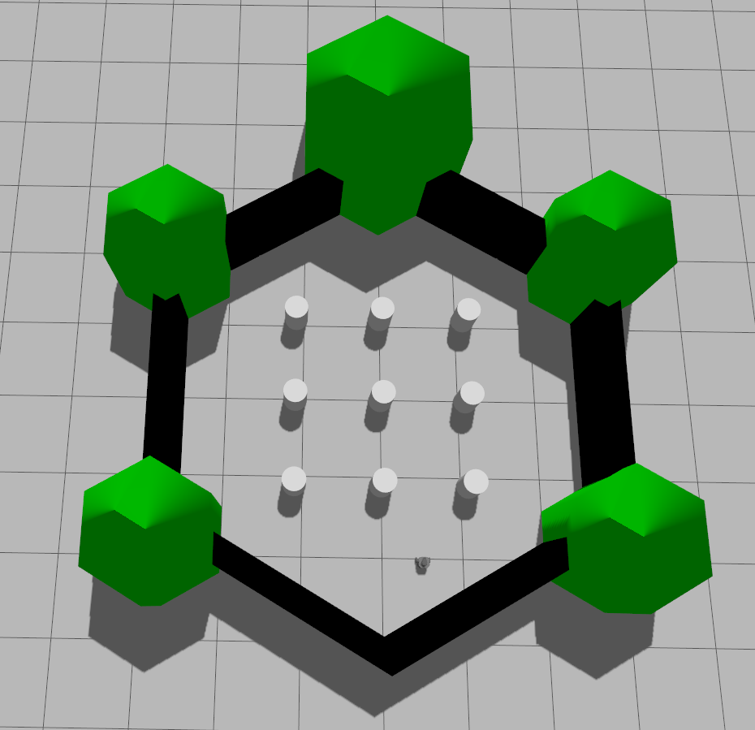

# Differential-Drive Robot Navigation

A ROS 2-based navigation project for a differential-drive mobile robot. This project integrates A* global path planning, B-spline path smoothing, and Model Predictive Control (MPC) for robot navigation in a static environment.

## 1. Project Overview

This project aims to develop a modular navigation system for a differential-drive mobile robot using ROS 2.

The system consists of three main modules:

- **A* Global Path Planning:** Generates a global path from the start position to the goal based on an occupancy grid map.
- **B-Spline Path Smoothing:** Smooths the global path to improve path continuity and reduce sharp turns.
- **Model Predictive Control (MPC):** Calculates linear and angular velocity commands to track the smoothed reference path.

The overall navigation pipeline is:

**Occupancy Grid Map → A* Path Planning → B-Spline Smoothing → MPC Tracking → Robot Motion**

## 2. Demo

The following animation demonstrates the robot navigation process.



## 3. System Architecture

The navigation system consists of three main modules: A* global path planning, B-spline path smoothing, and MPC trajectory tracking.

### Navigation Pipeline

```text
       Occupancy Grid Map
               |
               v
       +----------------+
       | A* Path Planner|
       +----------------+
               |
               | /astar_path
               v
       +----------------+
       | B-Spline       |
       | Smoother       |
       +----------------+
               |
               | /bspline_path
               v
       +----------------+
       | MPC Controller |
       +----------------+
               |
               | /cmd_vel
               v
       +----------------+
       | Mobile Robot   |
       +----------------+
               |
               | /odom
               v
         MPC Feedback
```

### Module Description

- **A* Global Path Planning:** Searches the occupancy grid map to generate a path from the start position to the goal.
- **B-Spline Path Smoothing:** Processes the path generated by A* to improve its continuity.
- **MPC Trajectory Tracking:** Uses the reference path and robot odometry to calculate velocity commands.
- **Closed-Loop Control:** Uses odometry feedback to update control commands and improve path tracking.

## 4. Main Features

- **Global Path Planning:** Uses the A* algorithm to search for a path on an occupancy grid map.
- **Path Smoothing:** Uses B-spline curves to smooth the global path.
- **Trajectory Tracking:** Uses Model Predictive Control (MPC) to calculate linear and angular velocity commands.
- **ROS 2 Integration:** Connects navigation modules through ROS 2 topics.
- **Map Support:** Uses an occupancy grid map for static-environment path planning.
- **Modular Design:** Separates global planning, path smoothing, and motion control into independent modules.

## 5. Path Planning and Smoothing

The A* algorithm generates a global path on the occupancy grid map. B-spline smoothing then improves the path continuity for subsequent trajectory tracking.



## 6. Simulation Environment

The project uses a simulated mobile robot environment for navigation development and testing.



## 7. MPC Path Tracking

The MPC controller calculates linear and angular velocity commands based on the reference path and robot odometry.


## 8. ROS 2 Topics

The navigation modules communicate through ROS 2 topics.

| Topic | Message Type | Description |
|---|---|---|
| `/astar_path` | `nav_msgs/Path` | Global path generated by A* |
| `/bspline_path` | `nav_msgs/Path` | Smoothed reference path |
| `/odom` | `nav_msgs/Odometry` | Robot odometry information |
| `/cmd_vel` | `geometry_msgs/Twist` | Linear and angular velocity commands |

*Note: Verify topic names and message types against the actual node implementations.*

## 9. Project Structure

```text
Differential-Drive-Robot-Navigation/
├── docs/
│   └── images/
│       ├── navigation_demo.gif
│       ├── astar_bspline_comparison.png
│       ├── gazebo_environment.png
│       └── mpc_tracking.png
├── maps/
│   ├── agv_map.pgm
│   └── agv_map.yaml
├── src/
│   ├── agv_navigation/
│   │   └── agv_navigation/
│   │       ├── astar.py
│   │       ├── astar_node.py
│   │       ├── bspline.py
│   │       └── bspline_node.py
│   └── agv_controller/
│       └── agv_controller/
│           ├── mpc.py
│           └── mpc_node.py
├── .gitignore
└── README.md
```

*Note: This is a simplified overview. The repository may contain additional package configuration files and dependencies.*

## 10. Development Environment

- **Operating System:** Ubuntu 24.04
- **ROS Distribution:** ROS 2 Jazzy
- **Programming Language:** Python
- **Visualization Tool:** RViz2
- **Simulation Environment:** Gazebo Sim

## 11. Installation

### 11.1 Clone the Repository

```bash
git clone https://github.com/hyx10-10/Differential-Drive-Robot-Navigation.git
cd Differential-Drive-Robot-Navigation
```

### 11.2 Source ROS 2

```bash
source /opt/ros/jazzy/setup.bash
```

### 11.3 Install Dependencies

If `rosdep` is installed and the package manifests declare the required dependencies, run:

```bash
sudo apt update
rosdep update
rosdep install --from-paths src --ignore-src -r -y
```

Additional dependencies or simulation resources may be required depending on the local environment.

### 11.4 Build the Workspace

From the workspace root, run:

```bash
colcon build --packages-select agv_navigation agv_controller --symlink-install
```

### 11.5 Source the Workspace

```bash
source install/setup.bash
```

*Note: The exact runtime commands and dependencies should be verified against the package configuration files and launch setup.*

## 12. Map

The project includes an occupancy grid map for global path planning.

| File | Description |
|---|---|
| `maps/agv_map.pgm` | Occupancy grid map image |
| `maps/agv_map.yaml` | Map resolution, origin, and image configuration |

The A* planner uses the occupancy grid map to search for a path from the start position to the goal while considering occupied cells.

## 13. Current Development Status

The project focuses on integrating global path planning, path smoothing, and trajectory tracking into a ROS 2 navigation pipeline.

Current development areas include:

- A* global path planning.
- B-spline path smoothing.
- MPC-based trajectory tracking.
- ROS 2 communication between planning and control modules.
- Static-environment navigation.

Further testing is needed to evaluate the complete navigation pipeline and quantify its performance.

## 14. Future Work

Planned improvements include:

- [ ] Improve obstacle handling and obstacle inflation.
- [ ] Evaluate path length and smoothness.
- [ ] Measure MPC trajectory-tracking error.
- [ ] Compare the original A* path with the smoothed path quantitatively.
- [ ] Simplify installation and launch procedures.
- [ ] Explore dynamic obstacle avoidance.
- [ ] Evaluate navigation performance in different environments.

## 15. Author

**GitHub:** [hyx10-10](https://github.com/hyx10-10)

## 16. License

No license has been added to this repository yet.